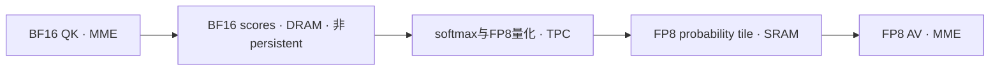

# MOSS各层剩余空间与第四层投入判断

2026-11-12，Asia/Shanghai。针对用户提供的分层表复核现有记录、实际FX／编译后图、当前安装的bridge源码和厂商公开接口。本轮新增结果来自既有原始数据的只读复算。

## 投入判断

下一阶段主攻图编译器／HPU bridge与attention kernel的联合数据流优化，文本提交链路作为第二主线。

当前证据支持工作流调度及模型常规接入、重排、扩区的收益明显收窄。设备kernel层仍有结构性机会，大Linear、attention、TPC非线性和文本小矩阵需要分别判断。现有试验覆盖程度支持调整研发优先级，全部候选的最优性证明仍然缺少。

本判断针对现有权重、1024²、25步、单图warm和质量保值条件。cold、多请求吞吐、其它尺寸及全新模型算法具有各自的成本结构。

## 前三层的证据与边界

| 层次 | 已覆盖证据 | 当前判断 |
|---|---|---|
| ComfyUI工作流调度／UI | 最新5次warm中，节点执行区间之外为15.50–16.79ms，中位15.90ms，约占服务端执行窗口0.1% | 该口径下可以降到低优先级，秒级加速需要进入模型节点内部 |
| ComfyUI模型实现 | 已完成CPU fallback清理、dtype与量化入口、条件预计算、GDN／KV状态、编译区域及head布局优化，近期9种布局和分块改写缺少稳定新收益 | 现有常规路线已经收窄。文本设备侧控制、提交批处理和持久执行结构仍有未分离的机会 |
| 大Linear kernel | BF16真实权重轮换374–404TF/s，FP8 Linear约806TF/s，分别接近对应峰值 | 大Linear原语的剩余百分比已经较小 |
| Attention及TPC复合kernel | BF16 QK 2.406s、softmax 1.340s、FP8 AV 0.531s，其它kernel 2.652s。SiTU／量化原型、GDN及query分块只覆盖部分实现 | 剩余空间尚未收口，最重的attention机会集中在跨MME／TPC的分块、驻留及执行衔接 |

15.90ms按每次请求内全部node_start／node_end区间的并集计算后扣除，避免重叠计数。范围为服务端执行窗口，浏览器渲染、排队和HTTP窗口之外的延迟另计。TextGenerate内部的Python控制和bridge开销包含在节点内。普通编码、VAE及图片输出也有真实工作量。[只读复算证据](evidence/moss-layer-boundary-audit-2026-11-12.json)

TPC原型失败只能约束已经实现的版本。尚未完成与当前舍入行为一致的norm／调制／量化／残差复合kernel的系统对照，SiTU的实际吞吐下限也没有独立证明。GDN原型从约0.182ms降到0.084ms，说明局部结构有潜力，其完整质量变化已使该版本退出产品。[撤回候选记录](MOSS_OPTIMIZATION_EXECUTION_2026-11-12.md)

## 新证据将attention问题进一步定位到第四层

本轮重新读取两组实际FX图和对应Synapse编译后图。

1. Attention的同一个FX图含24个matmul、24个softmax_fp8及26个FP8 GEMM，后者包括24个AV和投影。对应的编译后子图也包含QK、softmax和AV。
2. 每个条件下，24个完整BF16分数张量全部标为`persistent=false`、`in_persist_storage=false`，最终allocation为`DRAM`。
3. 正条件QK输出切片为`[4403,1536]`，末片为`[4403,1331]`，alias到完整`[4403,4403]`分数张量。softmax读取DRAM切片，FP8概率输出在SRAM中供AV消费。
4. 32MiB配置下仍观察到相同的分数驻留关系。90组输出及固定logits逐元素一致，但完整流程中位数16.101／16.064s、均值16.009／16.099s，收益未确认。

这组证据说明，attention中间量已经进入编译器可管理的生命周期，QK→softmax的数据流仍保留DRAM往返。最直接的调查点是bridge给出的布局／别名约束、混合精度算子lowering，以及Synapse的bundle、共同tile、SRAM容量和调度决策。需要同语义SRAM路径的A/B结果，才能确认可兑现收益，当前尚未定位到某条编译器源码规则。

本轮还观察到score的`allow_permutation=false`。它属于后续要核查的约束之一，现有证据没有证明它导致DRAM分配。分数张量逻辑大小与同时占用的物理workspace也需要按生命周期分别计算。[FX和tensor元数据](evidence/moss-layer-boundary-audit-2026-11-12.json)

## 文本链路仍有横跨第二、四、五层的空间

此前两轮短profile扰动较大。本轮使用已有GC控制的16轮窗口重新合并设备kernel区间。

| 指标 | 结果 |
|---|---:|
| 无profiler同步窗口 | 553.001ms |
| profiler同步窗口 | 559.853ms |
| 首末设备kernel跨度 | 548.497ms |
| 设备kernel活动并集 | 330.621ms |
| 跨度内kernel间隙 | 217.876ms，约39.7% |
| 最大单次间隙 | 0.966ms |
| launch_recipe接口事件 | 2288次 |

该窗口的profiler扰动约1.24%。接口的大小写事件属于不同记录层，计数保留原名。窗口间隙仍待归因到模型主机依赖、bridge提交、同步和运行时队列，各类等待的可消除比例及整段外推需要因果对照。文本控制路径因此继续保留研发空间。[原始profile的本轮复算](evidence/moss-layer-boundary-audit-2026-11-12.json)

## 把大幅提升换算为时间

以本轮16.101秒完整流程为参照，耗时降低10%需要节省1.610秒，降低20%需要3.220秒。下面是独立成本情景，采用已核对的六段DiT预算。

| 假设 | 时间变化规模 | 占完整流程 |
|---|---:|---:|
| 已计量FP8 Linear全部达到865TF/s理论峰值 | 约0.171s | 约1.1% |
| SiTU耗时减半 | 约0.505s | 约3.1% |
| 量化独占时间降至0 | 约0.200s | 约1.2% |
| 其它kernel整体耗时减半 | 约1.326s | 约8.2% |
| softmax及其它kernel整体耗时减半 | 约1.996s | 约12.4% |
| DiT现有kernel间隙降至0 | 约0.815s | 约5.1% |
| QK＋softmax预算减少35% | 约1.311s | 约8.1% |
| QK＋softmax＋AV整体耗时减半 | 约2.138s | 约13.3% |

SiTU和量化属于其它kernel预算，表内各情景存在包含关系。FP8 Linear一行只使用已计量的2.026677PFLOP和理论峰值估算。所有情景的实际净收益还取决于引擎重叠、访存、shape效率及新增实现成本。[公式与输入](evidence/moss-layer-boundary-audit-2026-11-12.json)

QK分数一次写出／一次读取的逻辑量约3.664TB。用已测1.982–2.148TB/s有效copy带宽换算，时间标尺约1.7–1.85秒，该流量已包含在QK／softmax执行中。实际模型HBM字节与饱和率仍受BMON校准缺口限制。

这支持把秒级目标放到attention数据流以及文本提交的结构性改变上。单个现有小算子的局部提速，所对应的完整流程预算通常更小。

## 第四层的可控范围

### Bridge具有可自行修改的源码入口

官方`gaudi-pytorch-bridge`提供源码及独立构建流程。本机版本为`1.24.2.481`，本轮核对`compilers.py`和`_passes/fuse_attention.py`，两份安装文件的Git blob哈希均与公开`v1.24.2`提交`27eccbcffeab10842c9f29f64c6bf50d8f65d78f`一致。可以从匹配版本的图变换、分区和算子lowering开展代码级对照。[官方bridge与构建说明](https://github.com/HabanaAI/gaudi-pytorch-bridge)、[本机源码匹配记录](evidence/moss-layer-boundary-audit-2026-11-12.json)

已读Python attention fusion pass注册普通FP32／BF16 SDPA模式，由`PT_HPU_USE_FUSE_SDPA_PASS`控制。当前BF16 QK→softmax_fp8→FP8 AV链需要专门审查其匹配和lowering覆盖，这两份文件没有给出该混合链已被整体融合的证据。该观察限定于本轮读取的文件。[固定版本编译入口](https://github.com/HabanaAI/gaudi-pytorch-bridge/blob/27eccbcffeab10842c9f29f64c6bf50d8f65d78f/python_packages/habana_frameworks/torch/dynamo/compile_backend/compilers.py)、[attention融合模式](https://github.com/HabanaAI/gaudi-pytorch-bridge/blob/27eccbcffeab10842c9f29f64c6bf50d8f65d78f/python_packages/habana_frameworks/torch/dynamo/compile_backend/_passes/fuse_attention.py)

当前softmax的bridge实现明确支持BF16输入及FP8输出，并将其转换为对应Synapse算子。下游算子的存在与整条链的共同驻留需要分别验证。[softmax_fp8 lowering](https://github.com/HabanaAI/gaudi-pytorch-bridge/blob/27eccbcffeab10842c9f29f64c6bf50d8f65d78f/hpu_ops/backend/softmax_fp8_gen.cpp)

### Synapse图规划更依赖厂商实现

厂商说明将融合、布局、并行、流水和内存管理列为图编译器职责。公开`SynapseAI_Core`将量产SynapseAI称为闭源，并注明参考实现只支持单节点图、同步执行等限制。当前公开参考库不足以提供本机量产图规划器的等价替换。[软件栈职责](https://docs.habana.ai/en/latest/Gaudi_Overview/Intel_Gaudi_Software_Suite.html)、[公开参考实现的范围](https://github.com/HabanaAI/SynapseAI_Core#limitations)

官方`UserCustomOpDescriptor`接口一次只描述一个TPC kernel。现有自定义TPC路线可用于SiTU、norm和量化融合，而MME→TPC→MME的片上协作还需要更深的bridge／Synapse接口或专门运行时设计。[CustomOp API限制](https://docs.habana.ai/en/latest/PyTorch/Reference/PyTorch_CustomOp_API/page_index.html#api-limitations)

已有直接MME／TPC／SCAL源码路线说明更低层实现存在可行性线索。该路线仍需适配当前SDK、MOSS形状、同步及质量，现有外部结果没有构成本机保值加速证明。[既有专项源码审查](JCHEN_GAUDI2_KERNEL_REVIEW_2026-11-10.md)

## 下一阶段的工程目标

1. **Attention作为主线。** 从当前混合精度链建立单head、N=4119／4403、D=128的最小复现，保留原有scale和舍入。对齐FX、bridge分区、Synapse图与设备时间线，找到score驻留及两侧tile无法衔接的具体原因，再验证复合lowering／bundling改动。
2. **文本提交作为第二主线。** 用16轮窗口关联主机控制、recipe入队和设备间隙，定位哪些等待可以通过设备侧控制、较大执行单元或持久buffer减少。其接入需要模型、bridge和运行时共同处理。
3. **TPC工作按明确预算配套推进。** norm／调制／量化或SiTU衔接以生成图中的真实读写和预算为依据，保留当前dtype和舍入对照。
4. **质量继续决定候选取舍。** 使用固定轨迹logits、真实block、同caption latent／图片和自然扩写。历史自然图已有复现差异，需要新鲜A/A对照量化基线变化。代码级编译优化同样需要这些验证。

本轮已足以确认研发重心应向第四层及第三／第四层交界转移。第三层上限、文本空档归因、精确HBM字节和代码级厂商栈A/B仍是证据边界。编译器代码修改后的净收益属于下一阶段待验证项。
