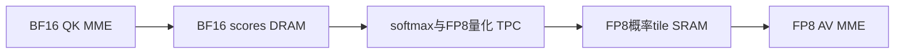

# DiT attention精度、布局与片上数据流

当前FP8主模型使用BF16 QK、融合softmax/FP8概率量化和FP8 AV。N≥8192时QK采用1536行query批次，softmax与AV保持二维。BF16主模型采用原dispatcher的单head编译。本文合并2026-11-09至11-13的算子、长序列及编译器调查，文本KV attention见 [文本decode](TEXT_DECODE.md)。

## BF16编译与head调度

真实N4408、D128的math SDPA从11.81→3.39ms，首轮模型所属attention区域编译使DiT37.916→28.217秒。共享动态SDPA虽过单测，真实图第6步SIGSEGV。加连续化后DiT28.995秒、图片MAE5.656，影响额外调用，最终使用模型范围内的编译。[失败补丁](../patches/rejected-shared-dynamic-sdpa.patch)

| 候选 | 真实block/attention结果 | 取舍 |
|---|---|---|
| 厂商默认FusedSDPA | attention3.60–3.61ms，block9.40ms，对照3.39/9.19ms | 无优势 |
| fast softmax | attention2.33ms、block8.10ms，FP64误差0.314%→0.721% | 质量不合格 |
| fast softmax＋FP32 K中心化 | block8.11–8.15ms，误差仍0.670% | 未解决精度问题 |
| FP32 softmax | attention11.41ms、block17.20ms | 更慢 |
| K/V补64/128并mask | 负block6.636→6.803/6.929ms | 适配成本抵消收益 |
| 早期query分块、显式contiguous | 无稳定完整block收益，native256负条件误差0.322%→0.400% | 未采用 |
| 每组24/12/8/6/4/3/2/1 heads | 单head正SDPA3.681→3.201ms，正block7.090→6.965ms，负6.579→6.605ms | 完整A/B/A确认约0.24秒收益 |

`700bdb6d`单head路径限定HPU BF16、batch1、24×128 heads、N≥4096、默认无mask/参考KV的编译推理，保留container/preferred_attention。产品固定caption缓存14.628→14.386秒、DiT14.376→14.134秒，各五轮。配对MAE0.09832，A/A约0.104，最大像素差均5。rank3、折叠batch/head和attention_basic未找到更优组合。

## FP8混合attention的建立

首轮SFT真实输入N4403，BF16按head约3.23ms，厂商FP8 fused整组/按head为14.748/15.320ms。直接QK/softmax/cast/AV约3.52ms，仍慢。后续用`softmax_fp8`合并概率量化后约2.867ms，概率scale由240改128减少额外误差。

Moody真实层0/20/41、步0/12/24、正负条件共18组。全FP8 QK/AV的敏感末层RRMSE18.5%–48.1%。逐head/逐行scale及K中心化的最佳敏感样本仍约8.57%，局部3.49ms，对照BF16约3.25ms。保留BF16 QK后代表层约2.62ms，最终18组RRMSE1.76%–3.07%、局部耗时比中位0.782。

`f67e7f3f`通过原attention dispatcher接入，模型forward请求`fp8_attention`，显式False有效。固定FP8文本298-token、1024²/25步、各五轮，完整18.936→17.191秒，DiT13.068→11.364秒。softmax预算2.701→1.356秒，FP8 MME2.515→3.046秒，主干矩阵FP8覆盖81.2%→90.6%。266项回归、同caption/seed三组图像、重载和原INT8通过，图片MAE8.986/3.069/8.561，细节有量化变化。

现行混合attention入口要求BF16激活、单batch/单head、D128、N≥4096、无mask及额外SDPA参数的编译推理，外层MOSS单head调度将24个head送入该路径。长序列上限的后续移除见下一节。

独立未归一化exp→FP8 AV→除分母的BF16/FP32版本约3.70/6.62ms，误差约1.0%–2.4%，较慢。更大head分组和早期query分块也无进一步收益。

### 概率量化的既有误差

标准高斯Q/K/V、N4403压力输入中，厂商概率输出相对FP32 softmax误差6.63%，显式CPU FP8量化参考2.75%，完整attention约7.31%。与厂商概率及CPU量化V的FP32乘法参考差0.236%。初始5%总体阈值失败后，该轮分解误差来源，采用8%总体量化检查及0.5%独立AV检查。该历史阈值属于原FP8算法验收，新保值改动继续对当前公式逐元素比较。

厂商softmax在分散分布的额外误差仍未完全解释。HPU eager/compiled的V量化舍入也不同，独立AV参考使用CPU量化V以定位矩阵误差。当前保值优化避免重复引入这些差异。

## 长序列8192性能断点

旧路径只在N4096–8192启用混合attention。用户1024×1824和1088×1936的总序列分别7651/7697与8583/8629，后一组退出快路径。`69fe4a54`移除上限，继续使用原BF16 QK与FP8 AV。

同进程、同caption、相同三组seed，1088×1936整图35.753→29.572秒，KSampler35.266→29.084秒，修复后1024×1824为23.721秒。宽1024、高1936/1952/1968的warm27.784/31.102/34.303→27.757/27.286/26.746秒，BF16对应34.862/36.166/36.896秒。

18组长图block对旧路径变化0.32%–3.42%，对FP32参考误差0.42%–3.62%→0.44%–3.97%，图像细节有变化。分散概率压力8193/8629/16385误差7.57%/7.74%/8.83%。逐行概率量化约3.7%–3.8%误差，但N8629耗时0.627ms、普通SDPA0.562ms，未采用。

扩展旧AV参考到8629时误差1.515%超0.5%，分解出约1.42%的V量化上下文差异。原独立AV覆盖保留，新增长序列完整输出对照。26个完整请求、306项广泛回归和最终30项attention专项通过，BF16跨界逐元素一致，混合shape卸载5,393,876,352 bytes。[断点证据](../evidence/moss-resolution-cliff-2026-11-12.json) · [修复证据](../evidence/moss-resolution-fix-2026-11-12.json)

## 质量保值布局与编译器筛选

| 候选组 | 覆盖与结果 | 结论 |
|---|---|---|
| 9种连续布局/转置/输出stack/head顺序 | 两组整block逐元素一致，布局约1%内，倒序/交错慢4%–11% | 无稳定收益 |
| 8组有效Synapse配置 | layered pipeline、attention seeds、flash slicing、SRAM32/24MiB、depth2/5、共享多buffer | API确认Set/Get，独立进程测量 |
| 24MiB SRAM预算 | 改变16,930/10,524个元素，RRMSE7.43e-5/6.42e-6 | 退出逐元素一致候选 |
| 32MiB SRAM预算 | 90组真实输入及固定logits一致，局部时间比中位1.00668 | 初筛约1%优势未复现 |
| 32MiB完整五轮 | 中位16.101/16.064s，均值16.009/16.099s | 方向不一致，且临时PNG丢失，未接入 |
| 短序列query分块256–2048 | 正/负最佳block5.079→5.697ms、4.718→5.085ms，误差约0.21%/0.28% | 无收益 |
| 2026-11-13 rank3、交换QK/AV、合并scale | N4119/4403可逐元素相同，QK交换7.49/8.42ms，双交换9.22/10.15ms，原约4.6/5.0ms | 无收益 |
| 同轮BF16 query批次512/1536 | 正条件约9.85/7.88ms并有舍入变化 | BF16采用原路径 |

## 长序列query批次的最终收益

`ef16c195`对N≥8192将query补齐为1536行批次，以BMM表达QK。softmax与AV保留二维并裁掉输出padding，恢复18组真实长图block逐元素一致。N8583/8629局部约13.51/13.61ms，原约13.7–14.0ms。

1088×1936同caption、交错A/B、各五轮，整图中位29.644906→28.891517秒，减少2.54%，两侧范围29.560778–29.663330与28.823021–28.898050秒。三组seed五对PNG MAE0.07799–0.08026、最大差3，A/A为0.07949–0.08035、最大差3–4。

原型的modulo padding触发SymEngine Mod求值失败，局部静态长度标记可运行但有重编译风险。最终改成floor division，14次调用覆盖13个长序列长度，仅2份FX动态图，全部逐元素一致，18组真实block再验一致。专项含8191/8192/8193、零padding9216、16385及重复shape。五轮A/B来自静态shape原型，最终公式另经动态检查和普通工作流验证。

同进程累计allocator高水位42.63→47.27GiB，含cold和两套recipe，请求结束InUse均22,021,936,384 bytes。1024×1824切换、512²重载、finite/fallback检查通过。最终attention/RoPE专项37项通过。[最终证据](../evidence/moss-three-stage-2026-11-13.json)

## 编译后存储与后续思路

实际FX图已有24个QK、24个softmax_fp8及24个AV。完整scores均`persistent=false`、`in_persist_storage=false`，仍位于DRAM。QK tile为`[4403,1536]`，softmax读`[4403,2048]`，FP8概率tile在SRAM中直接供AV使用。32MiB设置、rank3和最终query批次均保留这一分配。

已确认的scores一次写读逻辑量约3.664TB/图，实际HBM事务待BMON校准。当前机会在QK→softmax的共同tile、布局/别名约束、bundle和MME/TPC协作。`allow_permutation=false`与DRAM分配的因果关系尚未证明，`setSynapsePermuteFlag`已读入口主要涉及persistent/图输出。

在线softmax、跨片归一化和输出累加可能改变舍入，新实现需要保留当前QK精度并用90组真实输入和完整图检查。直接MME/TPC外部路线的SDK、描述符和质量限制见 [源码参考](KERNEL_REFERENCES.md)，可兑现秒数见 [瓶颈预算](BOTTLENECKS.md)。

## 复现入口

原始目录为`performance-2026-11-09-dit`、`performance-2026-11-11-bf16-next`、`performance-2026-11-12-fp8-deep`、`performance-2026-11-12-quality-preserving`、`performance-2026-11-12-evidence`、`performance-2026-11-12-resolution-fix`及`performance-2026-11-12-three-stage`。使用`moss_dit_replay.py`、`moss_attention_dataflow_screen.py`、`moss_attention_dataflow_validate.py`、`moss_attention_dynamic_check.py`和`moss_attention_pipeline_compare.py`。[混合精度证据](../evidence/moss-fp8-deep-2026-11-12.json) · [编译器筛选](../evidence/moss-quality-preserving-2026-11-12.json) · [图与驻留](../evidence/moss-layer-boundary-audit-2026-11-12.json)
